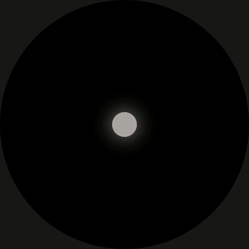
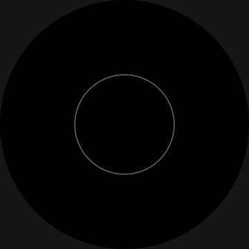
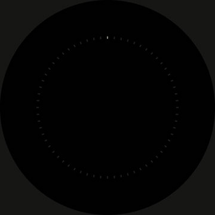
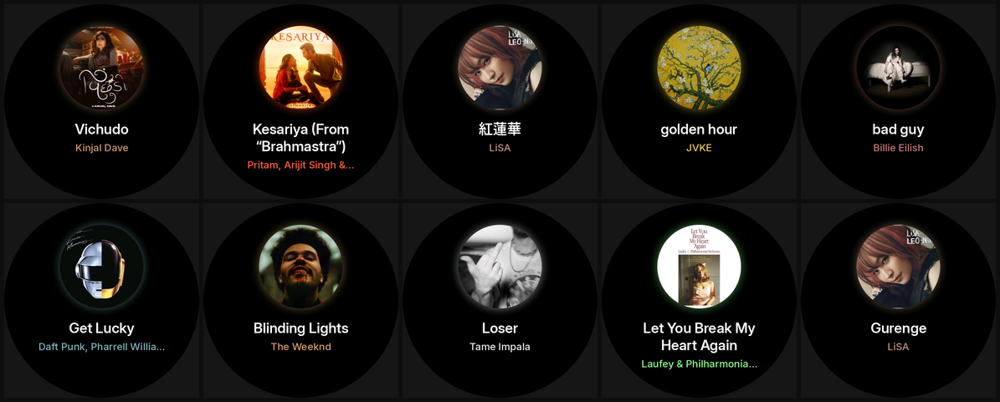
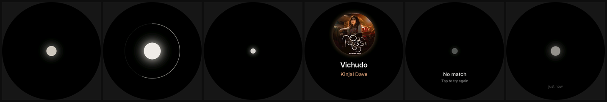
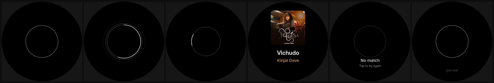
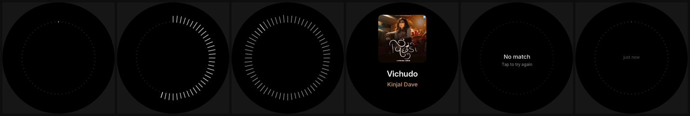

# shaza

Tap the round screen, it listens to the room for five seconds, and shows the song that is playing: the cover, the title and the artist, in a colour taken from the cover. That is the whole product. No menus, no settings.

Built for the Waveshare ESP32-S3-Touch-AMOLED-1.75C (466x466 round AMOLED). It runs on its own: the board fingerprints the audio itself, asks Shazam over Wi-Fi, fetches the cover and draws everything. No laptop, no server, no API key. A simulator runs the same code on a laptop with the laptop's microphone.

<p align="center">
  
  
  
</p>

Real songs, recognised and rendered by the actual code:



## Status

What has been checked, and how:

- **It works on the board, standalone.** Tapped with music playing, the board recognised For A Reason (Karan Aujla & Ikky): Shazam answered in 0.8 s and the cover was on screen 1.6 s after listening ended. Before that it found a song through the board's microphones for the person who built it, so at least two songs, not yet the handful the goal asks for.
- **The fingerprint matches the reference.** `core/signature.cpp` is a C++ port of [shazamio-core](https://github.com/shazamio/shazamio-core)'s fingerprint (MIT). On two real recordings from the board's microphones it finds the same peaks as shazamio-core's own code (294 of 294 and 285 of 285, all but six of them bit for bit), and Shazam recognises the song (WILDFLOWER, Billie Eilish) from the C++ signature.
- **The microphones work.** No all-zero samples, both channels within about 1 dB of each other, about -40 dBFS in a quiet room and -27 dBFS with music, peaks around -17 dBFS at 30 dB gain.
- **Tests pass:** `make test` runs 24 relay tests and eight C++ suites, about 330 checks.
- **Frame times on the board are not good enough yet.** Measured before the latest drawing change: the listening animation rendered in 74 ms a frame (about 11 fps) and the breathing ready orb in 10 to 13 ms. Rings and glows now come from a distance table instead of a square root per pixel, which is unmeasured on the chip so far. Still screens send nothing and run at 60 fps. See [Smoothness](#smoothness).
- **Not verified:** running on battery, a handful of songs on the board, and titles outside Latin, Greek and Cyrillic (they fall back to the artist's name).

## How it works

```
 board                                                                 internet
 -----                                                                 --------
 tap: the mics are read in 20 ms blocks and fed to the fingerprint
 as they arrive (an FFT, then the loudest spectral peaks)
 after 5 s, POST the fingerprint (about 2 KB) over HTTPS  ---------->  Shazam's recognition endpoint
 read title, artist and cover link from the JSON reply   <----------
 GET the cover, asked for at exactly 200x200  ---------------------->  Apple's image server
 decode the JPEG, pick an accent colour from it, lay out
 the title and artist in Inter, and open the cover out of the orb
```

The fingerprint is Shazam's own format, the same thing its app sends: never the audio. Shazam's endpoint is unofficial. It can change or stop answering without notice, and using it is against Shazam's terms, so this is a personal project, not a product.

Titles are laid out on the board from a glyph atlas baked from Inter: every Latin, Greek and Cyrillic letter Inter has, at two sizes, with kerning, wrapped to two lines and ending in an ellipsis when they do not fit. A title in a script the atlas lacks (Chinese, Devanagari) shows the artist in its place. The accent colour is the most common colourful hue on the cover, lifted so it reads on black.

**Privacy:** every tap sends a fingerprint of five seconds of whatever the room sounds like to Shazam.

`relay/` holds the first design, kept as an option: a laptop script the board can upload audio to, which renders titles in any script with laptop fonts and falls back to AudD. The simulator's live mode still uses it.

## Try it in the simulator

You need a C++17 compiler, SDL2, [uv](https://docs.astral.sh/uv/) and curl. On Fedora: `sudo dnf install gcc-c++ SDL2-devel`; on Ubuntu: `sudo apt install g++ libsdl2-dev`.

    git clone --recursive https://github.com/xevrion/shaza
    cd shaza
    make test

**Without a microphone or network**, the simulator plays made-up music levels and answers from the saved replies in `host/fixtures`:

    make fake

**For real**, start the relay in one terminal and the simulator in another, then play a song out loud (from a phone or the laptop speakers, not into earbuds) and click the circle:

    make relay      # first run creates a token in ~/.config/shaza/token
    make sim

Keys: click or space taps the screen, `D` switches between the three looks, `W` pretends the Wi-Fi dropped, Esc quits. The window title shows the look, the phase and how many pixels each frame would send to the panel.

The relay needs Python 3.12 or older. shazamio uses pydub, which needs the `audioop` module that Python 3.13 removed, and its compiled core crashes on 3.14. `uv run` picks a suitable Python on its own.

## The relay (optional)

    uv run relay/shaza_relay.py                   # listens on 0.0.0.0:8788
    uv run relay/shaza_relay.py --save recordings # also keeps every clip, to listen to
    uv run relay/shaza_relay.py --try clip.wav    # recognise a file and print the reply header

It asks Shazam first, with an 8 second limit, and AudD second. AudD answers about ten requests a day without a token. For more, sign up at AudD (300 free requests) and put the token in `~/.config/shaza/audd_token`. That file lives outside the repo; never paste it anywhere else.

Requests need the shared token in an `X-Shaza-Token` header. Endpoints: `POST /listen?art=200&tw=360&ts=34&aw=320&as=24` with a 16 bit WAV as the body, and `GET /health`.

## On the board

The build runs ESP-IDF 5.5.1 in Docker through `roundkit/scripts/idf`, so nothing else has to be installed. The image is about 12 GB. Put your Wi-Fi login in `main/secrets.h` first (it is git-ignored; never commit it or paste it anywhere):

    cp main/secrets.example.h main/secrets.h    # then edit it
    make build
    make flash PORT=/dev/ttyACM0
    python3 tools/monitor.py --port /dev/ttyACM0     # the log: phases, what Shazam said, frame times

The Wi-Fi code joins WPA2-Enterprise (PEAP) networks, the usual campus setup. Flashing replaces whatever firmware is on the board.

The log prints, for each phase, how long frames take to draw and to send and how many pixels they send, and for each recognition the fingerprint size and how long Shazam took. Two build options help:

- `./roundkit/scripts/idf -DSHAZA_MICTEST=1 build` builds the microphone test instead: two level bars, and four second recordings at boot and on every tap that `python3 tools/grab_wav.py` saves as WAV files to listen to. Check first that the samples are not all zero and that a clap is clearly louder than the room.
- `./roundkit/scripts/idf -DSHAZA_AUTOTAP=1 build` taps the screen by itself 20 s after every result, to measure frame times through every phase without anyone there. It keeps asking Shazam until it is reflashed, so do not leave it on.

## Three looks

They differ in how they listen. Orb is the default; `D` switches between them in the simulator.

**Orb**: a small glowing pearl that swells with the room inside a faint progress ring, shrinks to a slow heartbeat while thinking, and opens into a round cover with a glow in the cover's colour. The thing you watched listening becomes the answer.



**Halo**: one hairline ring that breathes. Listening sends thin ripples out of it, as strong as the room is loud, while a bright arc fills clockwise over the five seconds. Thinking is a short comet arc going round. The cover is a rounded square.



**Dial**: 64 fine ticks round the edge. Listening sweeps once round them and each tick keeps the loudness it heard, so the clip is left drawn as a groove. Thinking sends one bright tick round the groove.



Left to right: ready, listening, thinking, found, no match, ready again with the time since the last song.

## Smoothness

Sending to the panel measured 3 to 4 megapixels a second on the board, so a full screen (217k pixels) would cost over 50 ms. Each look describes its frame as a few items, each with a box and a key that changes whenever the item would look different. Only items whose key changed are repainted, clipped to their box, and a screen that is not moving sends nothing.

Pixels sent per frame in a scripted run (`make shots`), averaged over each phase:

| | ready | listening | thinking | found | no match |
|---|---|---|---|---|---|
| orb | 20k | 75k (worst 99k) | 30k | 15k | 1k |
| halo | 18k | 79k (worst 94k) | 42k | 9k | 1k |
| dial | 3k | 6k | 12k | 9k | 1k |

The dial breaks the budget on purpose for a single frame whenever every tick changes at once (a new phase starting), which repaints the whole dial: about 149k pixels, one late frame.

On the board, with the orb, before rings and glows were tabulated:

| phase | render per frame | send per frame | pixels | frames drawn |
|---|---|---|---|---|
| ready (breathing) | 10 to 13 ms, worst 40 | 3.5 ms | 33k worst | about 20 to 30 a second |
| listening | 74 ms | 17.6 ms | 73k | about 11 a second |
| thinking (after the first frames) | 1 to 11 ms | 2 to 4 ms | up to 12k | smooth |
| found, no match | 0.1 to 0.5 ms | 0 to 0.2 ms | 0 to 0.6k | 60 a second, nothing to send |

So the listening animation is far from smooth on the chip yet. The first fix, drawing rings and glows from a table of distances instead of a square root and a division per pixel, is in; its effect on the chip is not measured yet. Moving the Shazam request off the drawing core already removed 300 ms freezes during the TLS handshake.

## Tests

    make test

| Suite | What it checks |
|---|---|
| `relay/test_relay.py` | wrapping and ellipsis, fonts for each script, accent colours, RGB565, the reply format, falling back from one service to the next |
| `host/test_audio.cpp` | the WAV header, loudness in dBFS, the level meter |
| `host/test_paint.cpp` | rings, arcs and glows against a per-pixel reference for 300 random shapes, clipping, masks, images |
| `host/test_app.cpp` | parsing every saved reply and every truncation of it, malformed replies, the state machine (cancel, time out, late replies, no Wi-Fi) |
| `host/test_look.cpp` | each look drawn incrementally matches a full repaint on every frame; a still screen sends nothing |
| `host/test_signature.cpp` | the fingerprint against shazamio-core's own on two real board recordings, feeding audio in pieces, the binary format, a pure tone landing in its band |
| `host/test_shazam.cpp` | the request body and path, real Shazam replies (a match and no match) and every truncation of one, awkward JSON |
| `host/test_text.cpp` | title layout against the relay's Pillow rendering of nine real titles, wrapping, kerning, which scripts can be drawn, the accent colour on real covers |

`make media` rebuilds the GIFs and screenshots in `docs/` (needs ffmpeg).

## Layout

| Path | What |
|---|---|
| `core/` | The state machine, the Shazam fingerprint and request, JSON, text layout, drawing and the three looks. Pure C++, no ESP-IDF. |
| `host/` | Tests, the simulator, and fixtures: board recordings, real Shazam replies, saved relay replies. |
| `main/` | Firmware: Wi-Fi, the microphone task, the recognition task (HTTPS, the cover), the frame loop, and the microphone test. |
| `relay/` | The optional laptop relay, one Python file. |
| `tools/` | `monitor.py` (the board's log), `grab_wav.py` (recordings off the board), `make_font.py` (the glyph atlas), `make_media.py` (the pictures here). |
| `fonts/` | Inter, used by the relay and baked into the atlas. |
| `roundkit/` | Shared code for this board, a [submodule](https://github.com/xevrion/roundkit). |

## License

MIT for the code. Inter is under the SIL Open Font License 1.1, see `fonts/LICENSE.txt`. Album covers in the screenshots and fixtures belong to their owners and are shown only to demonstrate the display.
